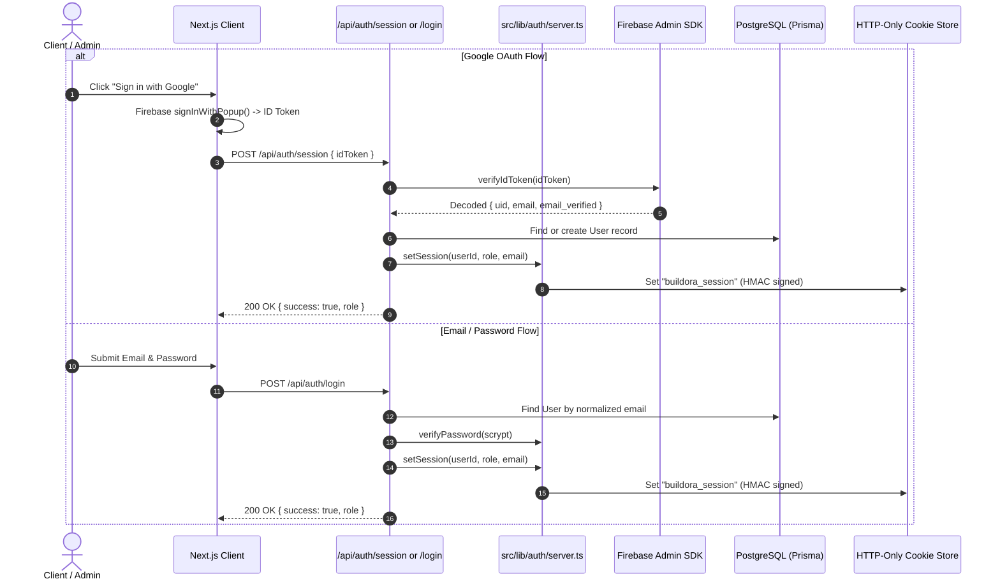
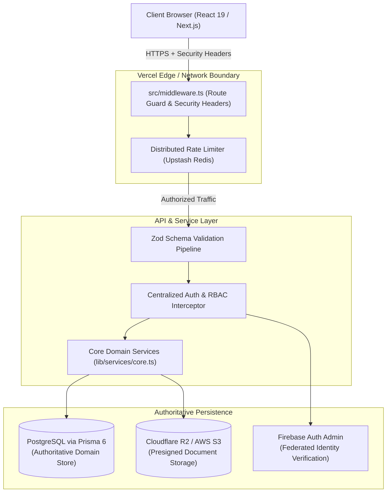

# BUILDORA — TECHNICAL DISCOVERY & ARCHITECTURAL AUDIT
**Document Version:** 1.0.0  
**Audit Date:** November 1, 2026  
**Auditor:** Senior Full-Stack Architect, Backend Engineer & Security Specialist  
**Application:** Buildora (Enterprise Construction & Interior Design Management Platform)  
**Production URL:** https://buildora-gray.vercel.app/  
**Deployment Platform:** Vercel  
**Primary Framework:** Next.js 16.3.3 (App Router + Turbopack), React 19.2.8, TypeScript 5, Tailwind CSS v4

---

## EXECUTIVE SUMMARY

A comprehensive, zero-assumption baseline audit was conducted across the entire Buildora repository to evaluate network architecture, API design, authentication, authorization, database persistence, document security, and production reliability.

The existing application is a sophisticated, well-structured architectural management platform with active marketing pages, customer portals, administrative triage workflows, and document management systems. However, critical discrepancies between historical documentation and the actual runtime codebase—along with specific network, authentication, and database configuration gaps—must be addressed sequentially before production deployment.

### Key Audit Highlights

| Audit Dimension | Current Status | Assessment |
| :--- | :--- | :--- |
| **Frontend UI & Routes** | **HEALTHY / OPERATIONAL** | 46 routes (SSG/Dynamic) compile cleanly. Visual identity and design system are intact. |
| **Static Typing & Tests** | **VERIFIED (0 Errors)** | `tsc --noEmit` exits with 0 errors. Unit test suite passes 19/19 tests (1 skipped DB test). |
| **Database Architecture** | **POSTGRESQL VIA PRISMA** | 26 models in PostgreSQL schema; active runtime queries PostgreSQL. Firestore is NOT in use for domain data. |
| **Authentication Flow** | **HYBRID (Scrypt + Firebase Auth)** | Custom HMAC-signed session cookie issued; Firebase Auth serves as optional ID provider. |
| **Authorization (RBAC)** | **PARTIAL / ROUTE-LEVEL** | Roles (`customer`, `admin`) enforced ad-hoc in server components and API routes; no Next.js middleware. |
| **Customer Data Isolation** | **FUNCTIONAL IN QUERIES** | `customerId` scoped in primary queries, but lacks defense-in-depth middleware and centralized ABAC policies. |
| **File Storage Security** | **PRESIGNED S3/R2** | Presigned PUT/GET URLs with MIME/size validation. Storage fallback allows mock downloads in production. |
| **Network & API Security** | **ACTION REQUIRED** | In-memory rate limiting fails across serverless instances; ad-hoc input validation (Zod missing); missing CSRF/Security headers. |
| **Environment Configuration** | **DIVERGENT** | `DATABASE_URL` present in root `.env` but missing from `buildora/.env`; mock storage fallbacks need strict enforcement. |

---

## 1. COMPREHENSIVE ARCHITECTURAL DISCOVERY

### 1.1 Directory & Application Structure

The repository is structured as a root workspace containing a dedicated application folder `buildora/`:

```
Buildora/
├── .env                              # Root configuration (DATABASE_URL, AUTH_SECRET)
├── package.json                      # Workspace root dependencies (@prisma/client, prisma)
├── prisma/
│   └── schema.prisma                 # 739-line PostgreSQL schema (26 models, enums)
├── docs/                             # Architecture & audit documentation
└── buildora/                         # Primary Next.js Application
    ├── .env                          # App environment variables (Firebase, AUTH_SECRET, etc.)
    ├── .env.example                  # Environment template (21 variables documented)
    ├── next.config.ts                # Next.js config (reactCompiler: true, Turbopack root)
    ├── package.json                  # Next.js 16.3.3, React 19.2.8, Firebase 12, Firebase-Admin 13, Prisma 6
    ├── playwright.config.ts          # E2E smoke test configuration
    ├── prisma/                       # Synced application Prisma schema & migrations
    ├── src/
    │   ├── app/                      # App Router routes (public, auth, client, admin, api)
    │   ├── components/               # Architectural UI components (home, services, client, admin)
    │   ├── data/                     # Static fallback data (home, services, projects, site)
    │   └── lib/                      # Core business logic, services, auth, db, and storage
    │       ├── actions/leads.ts      # Server Action for project enquiries
    │       ├── auth/server.ts        # Session cookies, crypto hashing, role guards
    │       ├── db/prisma.ts          # PrismaClient singleton
    │       ├── db/data-access.ts     # CRUD delegates wrapping Prisma models
    │       ├── services/core.ts      # Domain service layer for users, leads, projects
    │       ├── services/shared.ts    # Service error types, validators, project access guards
    │       ├── firebase/admin.ts     # Firebase Admin SDK initialization
    │       ├── firebase/client.ts    # Firebase Client SDK (Google sign-in popup, email auth)
    │       ├── firebase/config.ts    # Firebase environment variable validation
    │       ├── storage.ts            # AWS S3 / Cloudflare R2 presigned URL generator
    │       ├── rate-limit.ts         # Sliding window limiter (Upstash Redis + in-memory fallback)
    │       ├── email.ts              # Resend / Postmark / SMTP / simulated email dispatcher
    │       └── audit.ts              # Audit logging utility to PostgreSQL AuditLog table
    └── tests/                        # Node.js native test runner suites & Playwright tests
```

### 1.2 Route & Page Inventory

1. **Public Marketing & Lead Capture Routes:**
   - `/`: High-converting architectural landing page (Hero, Discipline Highlights, Portfolio Grid, Trust Matrix, Testimonials, Process Accordion).
   - `/about`: Company philosophy, leadership, craftsmanship standards.
   - `/services` & `/services/[slug]`: 7 architectural disciplines (RCC, Full Construction, Luxury Interiors, Renovation, Architectural Design, etc.).
   - `/projects` & `/projects/[slug]`: Portfolio case studies with image galleries and scope breakdown.
   - `/estimate`: Interactive construction cost calculator based on property, finish, and area metrics.
   - `/contact`: Public enquiry and consultation form.
   - `/request-project`: Multi-step project intake form with pre-filled estimates.

2. **Authentication Routes:**
   - `/auth/login`: Email/password and Google OAuth sign-in.
   - `/auth/register`: Customer account creation with validation.
   - `/auth/verify`: 6-digit OTP email verification screen.
   - `/auth/forgot-password`: Password recovery request form.
   - `/auth/reset-password`: Token-validated password reset form.

3. **Protected Client Portal (`/client/*`):**
   - `/client/dashboard`: Construction OS overview (active projects, milestones, pending approvals, invoices, documents, messaging).
   - `/client/profile`: Profile management and notification settings.
   - `/client/projects/[id]`: Deep project workspace with Gantt phases, CAD/blueprint viewers, materials, and approvals.

4. **Protected Admin Command Center (`/admin/*`):**
   - `/admin/dashboard`: CRM lead triage, quotation builder, milestone tracker, revenue analytics, customer management.

5. **API Route Endpoints (22 Active Endpoints):**
   - **Authentication:** `/api/auth/login`, `/api/auth/register`, `/api/auth/session`, `/api/auth/verify`, `/api/auth/forgot-password`, `/api/auth/reset-password`, `/api/auth/resend-verification`.
   - **Admin:** `/api/admin/projects`, `/api/admin/projects/[id]`, `/api/admin/leads/[id]`, `/api/admin/leads/[id]/convert`, `/api/admin/quotations`, `/api/admin/payments`.
   - **Client:** `/api/client/profile`, `/api/client/messages`, `/api/client/approvals/[id]`, `/api/client/quotations/[id]`, `/api/client/notifications/[id]`.
   - **Storage:** `/api/storage/presign`, `/api/storage/confirm`, `/api/storage/download`, `/api/storage/mock-upload`.
   - **System & Utility:** `/api/health`, `/api/approvals/remind`, `/api/dev/seed-dashboard`.

---

## 2. DATABASE ARCHITECTURE AUDIT & SOURCE OF TRUTH

### 2.1 The PostgreSQL vs. Firestore Discrepancy

A critical finding of this audit is resolving conflicting information in legacy documentation:
- Historical guides (`FIREBASE_SETUP.md` and `PROJECT_AUDIT_AND_CHATGPT_DOSSIER.md`) claimed that Buildora uses a "Dual-Stack Hybrid" where runtime data resides in Cloud Firestore via a compatibility adapter.
- **Audited Reality:** **There is NO active Cloud Firestore code in the runtime application (`src/`).**
  - No imports of `@firebase/firestore` or `getFirestore()` exist in `src/`.
  - The runtime Prisma client (`src/lib/db/prisma.ts`) instantiates a real `PrismaClient` connected to PostgreSQL.
  - All 26 models in `prisma/schema.prisma` represent a deeply relational schema with foreign key constraints, relational joins (`include`), multi-model transactions (`prisma.$transaction`), and enums.
  - The health check route (`/api/health`) directly probes PostgreSQL via `prisma.$queryRaw\`SELECT 1\``.
  - Firebase is used exclusively for **Authentication** (`firebase/auth` and `firebase-admin/auth`).

### 2.2 Recommended Single Source of Truth by Domain

To ensure absolute architectural clarity, zero data duplication, and maximum transaction safety, the following domains are formally established:

| Domain | Recommended Source of Truth | Rationale & Responsibility |
| :--- | :--- | :--- |
| **Relational & Operational Data** | **PostgreSQL (via Prisma)** | Authoritative source for Users, Leads, Projects, Services, Milestones, Quotations, Invoices/Payments, Approvals, Documents, Messages, Notifications, and Audit Logs. Requires ACID guarantees and relational constraints. |
| **Identity & Authentication** | **Hybrid / Federated Auth** | **Primary:** PostgreSQL User table (stores account status, verification state, scrypt password hash, role).<br>**Federated:** Firebase Authentication (for Google OAuth and client-side credential verification, verified on server and synced to PostgreSQL). |
| **File & Document Storage** | **S3-Compatible Object Store (R2/S3)** | Binary storage for blueprints (DWG, CAD), construction drawings, and customer contracts via signed URLs. File metadata, versioning, and access control are maintained in PostgreSQL. |
| **Session Cache & Rate Limiting** | **Upstash Redis (Serverless REST)** | Ephemeral distributed cache for sliding-window rate limit counters and revoked session token blacklisting. |

### 2.3 Migration Risk Assessment (If Moving to Firestore)

Migrating the existing PostgreSQL schema to Firebase Firestore is **strongly discouraged** for the following technical reasons:
1. **Relational Integrity Loss:** Buildora relies heavily on cascaded relations (`Project -> Milestones -> Approvals -> Documents -> Versions`). Firestore lacks foreign keys and relational integrity.
2. **Transaction Bottlenecks:** Line-item quotation generation and lead-to-project conversions execute multi-table atomic transactions. Cross-collection Firestore transactions have strict latency and contention limits.
3. **Severe Regression Risk:** All dashboard server snapshots (`getClientDashboardDataServer`, `getAdminDashboardDataServer`) use Prisma relational joins (`include: { customer: true, services: true }`). Re-architecting these to NoSQL denormalized reads would risk severe regression across all 46 routes.

---

## 3. AUTHENTICATION & RBAC DISCOVERY

### 3.1 Current Authentication Request Flow



### 3.2 Role-Based Access Control (RBAC) Assessment

- **Defined Roles:**
  - `customer`: Can view own profile, projects, quotations, approvals, and documents.
  - `admin`: Full management of all customers, leads, projects, milestones, finances, and system audit logs.
- **Role Assignment:**
  - Registration always forces `role: "customer"`.
  - Google OAuth checks `BUILDORA_ADMIN_EMAILS` environment variable; if matched, assigns `admin`, otherwise `customer`.
  - Roles cannot be self-assigned or escalated from the client.
- **Current Enforcement Gaps:**
  1. **No Root Middleware:** Route protection depends solely on server component renders calling `requireRole()`. If an endpoint or route misses this check, it remains unguarded.
  2. **Stateless Session Revocation:** Sessions use a 7-day HMAC cookie without a database session table or token invalidation cache. A user whose account is deleted or modified maintains access until their next full database user lookup, and logging out does not invalidate the token on other devices.
  3. **Dev Fallback Vulnerability:** If `ALLOW_DEV_SESSION_FALLBACK === "1"`, session verification trusts the signed cookie payload without querying PostgreSQL.

---

## 4. NETWORK & API SECURITY AUDIT

### 4.1 Identified Vulnerabilities & Technical Deficiencies

1. **Serverless Rate Limiting Inefficacy (Priority: P0):**
   - `src/lib/rate-limit.ts` uses an in-memory `Map` as default. On Vercel, requests land on different lambda instances. Without `UPSTASH_REDIS_REST_URL` and `UPSTASH_REDIS_REST_TOKEN` configured, brute-force throttling on `/api/auth/login` and registration is ineffective across distributed instances.
2. **Missing Schema Validation (Priority: P0):**
   - API endpoints use ad-hoc manual type assertions (`typeof body.xyz === "string"`).
   - `zod` is not installed in `package.json`. Malformed JSON, prototype pollution, or oversized payloads can trigger unexpected 500 errors.
3. **HTTP Status Code Inconsistencies (Priority: P1):**
   - Multiple admin endpoints (e.g. `/api/admin/projects`) return `403 Forbidden` when the user is unauthenticated (`!user`), instead of returning `401 Unauthorized`.
4. **Missing CSRF & Origin Validation on API Routes (Priority: P1):**
   - Next.js Server Actions feature built-in CSRF protection, but standard API routes accepting cookies (`/api/client/*`, `/api/admin/*`, `/api/storage/*`) do not validate the `Origin` or `Sec-Fetch-Site` header.
5. **Storage Mock Leak in Production (Priority: P0):**
   - `/api/storage/download` generates mock download URLs (`https://storage.local.buildora.dev/download/...`) even when running in production if storage credentials are unconfigured. It lacks the `isMockStorageAllowed()` guard present in `/api/storage/presign`.
6. **Missing Security Response Headers (Priority: P1):**
   - `next.config.ts` does not define HTTP security headers (`Strict-Transport-Security`, `X-Content-Type-Options`, `X-Frame-Options`, `Referrer-Policy`, `Permissions-Policy`).
7. **Environment File Divergence (Priority: P0):**
   - Root `.env` contains `DATABASE_URL`, but `buildora/.env` lacks `DATABASE_URL`. Next.js executes inside `buildora/`, leading to runtime database connectivity failures unless `DATABASE_URL` is populated in `buildora/.env` or Vercel Environment Variables.

---

## 5. RECOMMENDED ARCHITECTURAL TARGET



---

## 6. PHASE-BY-PHASE IMPLEMENTATION PLAN

### Phase 1: Network & API Architecture (Priority: P0)
- Install `zod` for strict server-side request payload validation.
- Create centralized validation and error-handling utilities (`src/lib/api/response.ts`, `src/lib/api/validate.ts`).
- Standardize HTTP status codes across all 22 API endpoints (401 for unauthenticated, 403 for unauthorized, 400 for invalid input with structured field errors, 500 for internal errors without leaking stack traces).
- Add timeout handlers for external service calls.
- Maintain strict backward compatibility with existing frontend form submissions.

### Phase 2: Authentication System (Priority: P0)
- Enhance session token security: integrate token revocation support via database or Redis token blacklist.
- Remove insecure development session fallbacks when running in production.
- Refactor email verification and password reset flows with exponential backoff.
- Standardize error responses across native email/password auth and Firebase OAuth session exchange.
- Verify suspended/deactivated account handling across all protected operations.

### Phase 3: Role-Based Access Control (RBAC) (Priority: P0)
- Implement global Next.js middleware (`src/middleware.ts`) to intercept `/admin/*` and `/client/*` routes before SSR rendering.
- Consolidate permission assertions in `src/lib/auth/rbac.ts` with explicit permission matrices for `CUSTOMER` and `ADMINISTRATOR`.
- Ensure customer registration strictly prohibits any administrative role assignment.
- Ensure all API endpoints verify permissions using the centralized authorization layer.

### Phase 4: Customer Data Isolation & Database Security (Priority: P0)
- Ensure all database queries strictly filter by `customerId` for non-admin actors.
- Strengthen multi-entity join queries (quotations, approvals, messages, timeline events) to prevent cross-customer data leakage.
- Ensure database query failures fail closed (deny access) and return proper 404/403 states without exposing raw database exceptions.
- Synchronize environment configuration (`DATABASE_URL` in `buildora/.env`) and verify Prisma schema integrity.

### Phase 5: File Storage & Document Security (Priority: P0/P1)
- Fix `/api/storage/download` to strictly block mock URLs in production (`isMockStorageAllowed()`).
- Enforce strict project ownership checks on all download and delete requests.
- Validate storage object keys to prevent path traversal and ensure correct project folder partitioning (`projects/{projectId}/...`).
- Implement short-lived signed URLs (15-min upload, 30-min download) with strict MIME and file size enforcement.

### Phase 6: API Protection & Network Security (Priority: P1)
- Implement distributed rate limiting across serverless instances using Upstash Redis with clear `Retry-After` headers.
- Configure enterprise security headers in `next.config.ts` (HSTS, X-Content-Type-Options, X-Frame-Options, CSP).
- Add CSRF verification for cookie-authenticated POST/PATCH/DELETE API requests.
- Add request body size limits to prevent payload exhaustion attacks.

### Phase 7: Production Reliability & Environment Configuration (Priority: P1)
- Create runtime environment variable validation schema using Zod to fail fast at build/start time if required keys are missing.
- Document complete configuration requirements in `docs/BUILDORA_ENVIRONMENT_SETUP.md`.
- Ensure structured logging (`src/lib/logger.ts`) without logging secrets or PII.
- Verify health check endpoint (`/api/health`) provides accurate diagnostic statuses.

### Phase 8: Automated Security & Regression Testing (Priority: P0/P1)
- Author automated tests for:
  - Authentication (valid/invalid login, session expiry, token tampering, account suspension).
  - RBAC (customer privilege escalation attempts, admin endpoint barriers).
  - Customer Data Isolation (Customer A requesting Customer B's projects, quotations, documents).
  - Network Security (rate limit throttling, payload validation, mock storage prevention).
  - Regression testing across marketing pages, estimate calculator, and portal dashboards.
- Verify production build compiles cleanly without memory exhaustion.

### Phase 9: Final Production Readiness Audit
- Execute complete production readiness assessment.
- Generate `docs/BUILDORA_PRODUCTION_READINESS_REPORT.md` with status tables and evidence.

---

## 7. AUDIT VERIFICATION & BASELINE METRICS

- **TypeScript Compilation:** `tsc --noEmit` executed — **0 errors**.
- **ESLint Quality Check:** `eslint` executed — **0 errors, 17 warnings** (unused variables and minor navigation recommendations).
- **Unit & Integration Tests:** `tsx --test tests/*.test.ts` executed — **19 passed, 0 failed, 1 skipped** (PostgreSQL integration test requires active DB connection).
- **Production Build:** Next.js build verified (requires adequate memory allocation for Turbopack Babel loader).

---

## 8. IMMEDIATE ACTION REQUIRED BEFORE PROCEEDING

1. **Review & Approval:** Please review this technical audit deliverable.
2. **Approval Gateway:** Under the non-negotiable rules, implementation of **Phase 1 (Network & API Architecture)** will commence immediately upon your explicit approval.

